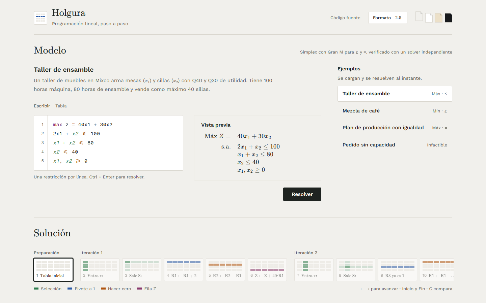
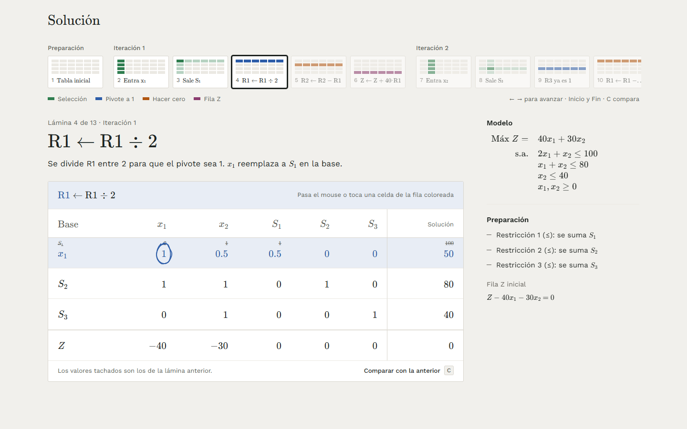
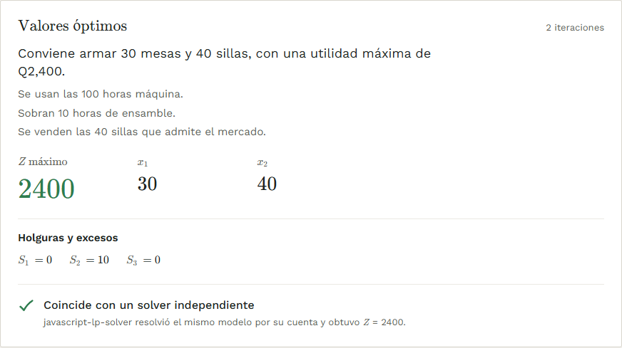
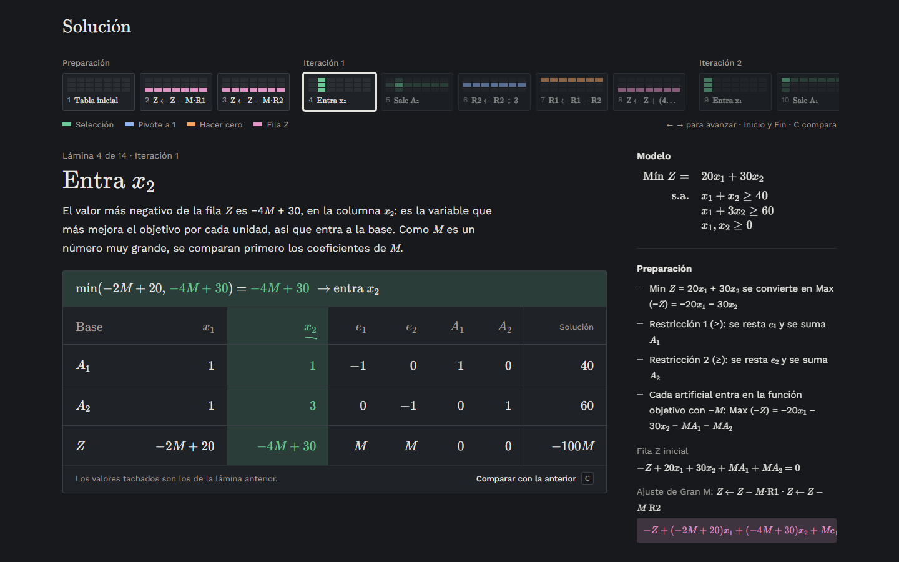
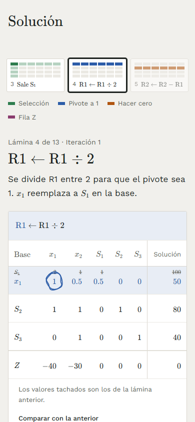

# Holgura

**Programación lineal, paso a paso.** Holgura resuelve problemas de programación lineal con el método Simplex y la Gran M, y muestra cada operación de renglón por separado: qué variable entra, cuál sale, cómo se lleva el pivote a 1 y cómo se hace cero cada fila, con el cálculo de cada celda.

**[Abrir la aplicación →](https://holgura-pink.vercel.app)**



## Qué hace

- **Entrada de dos formas.** Texto natural (`max z = 40x1 + 30x2`, una restricción por línea, con errores señalados por línea) o una tabla de coeficientes; las dos se mantienen sincronizadas, con vista previa en notación matemática.
- **Simplex completo.** Maximizar y minimizar, restricciones `≤`, `≥` e `=`, con el método de la Gran M para las artificiales.
- **Una operación por paso.** Entra, sale, pivote a 1, cada "hacer cero" y la fila Z son pasos distintos. Cada paso trae su explicación en español y su regla escrita como ecuación (`R2 ← R2 − 3 · R1`); al pasar el mouse sobre una celda que cambió se ve su cálculo (`60 = 120 − 3 × 20`).
- **Tira de láminas.** Una miniatura de la tabla por paso, con las celdas que toca cada operación entintadas en su color. Se navega con clic, flechas, Inicio/Fin o deslizando, y la tecla `C` compara con la lámina anterior.
- **Aritmética exacta.** Todo se calcula con fracciones exactas ([fraction.js](https://github.com/rawify/Fraction.js)); se muestra en decimales y con un botón en fracciones (`3/2` en vez de `1.4999`).
- **Casos especiales.** Detecta problemas infactibles, no acotados, con soluciones múltiples y degenerados, y explica por qué.
- **Verificación independiente.** Cada resultado se compara en el momento con [javascript-lp-solver](https://github.com/JWally/jsLPSolver), un solver que no comparte código con Holgura.
- **Ejemplos con contexto.** Cuatro problemas precargados (un taller de muebles en Mixco, una mezcla de café en Antigua, una cooperativa textil en Sololá y un pedido imposible para una panadería en Quetzaltenango) cuya solución se lee en el lenguaje de su historia: *"Conviene armar 30 mesas y 40 sillas, con una utilidad máxima de Q2,400."*
- **Cuatro temas** (Papel, Blanco, Sepia y Pizarra, oscuro), diseño adaptado a celular y modo de movimiento reducido.

| Un paso de la solución | Resultado con su lectura |
|---|---|
|  |  |

| Tema oscuro, Gran M | Celular |
|---|---|
|  |  |

## El método

1. **Forma estándar.** Cada restricción `≤` suma una holgura `Sᵢ`; cada `≥` resta un exceso `eᵢ` y suma una artificial `Aᵢ`; cada `=` suma una artificial. Para minimizar se trabaja con `Max (−Z)`.
2. **Gran M.** Cada artificial entra en la función objetivo con `−M` (un número muy grande), y la fila Z se ajusta para que las artificiales básicas tengan 0.
3. **Iteraciones.** La fila Z se escribe como `Z − c₁x₁ − c₂x₂ = 0`. Entra la variable con el coeficiente más negativo; sale la de razón mínima (solución ÷ coeficiente positivo). Se divide la fila pivote para que el pivote sea 1 y se hace cero el resto de la columna.
4. **Fin.** El óptimo llega cuando no quedan negativos en la fila Z. Si una artificial sigue en la base con valor positivo, el problema es infactible; si la columna que entra no tiene coeficientes positivos, no está acotado.

## Cómo se comprueba que funciona

- **103 pruebas automáticas** con [Vitest](https://vitest.dev) sobre problemas con solución conocida: entre ellos `Máx Z = 40x₁ + 30x₂` con `Z = 1040` y el taller con `Z = 2400` y holguras `0, 10, 0`.

  | Archivo | Qué prueba | Pruebas |
  |---|---|---|
  | `steps.test.ts` | cada paso, el cálculo de cada celda y los textos | 40 |
  | `parser.test.ts` | texto → modelo y errores por línea | 17 |
  | `bigm.test.ts` | minimizar, `≥`, `=` y la Gran M | 12 |
  | `verify.test.ts` | coincidencia con javascript-lp-solver | 12 |
  | `simplex.test.ts` | el núcleo del método y los casos especiales | 10 |
  | `fraction.test.ts` | aritmética exacta y formato | 6 |
  | `reading.test.ts` | la lectura de la solución de los ejemplos | 4 |
  | `setup.test.ts` | entorno de pruebas | 2 |

- **Verificación en vivo.** Cada vez que se resuelve un modelo, la aplicación lo resuelve también con javascript-lp-solver y muestra si coinciden el estado (óptimo, infactible, no acotado) y el valor de Z.

## Tecnología

| Parte | Herramienta |
|---|---|
| Interfaz | React 19, TypeScript, Vite |
| Estilos | Tailwind CSS 4, Work Sans, fuentes de KaTeX para la matemática |
| Matemática | KaTeX (notación), fraction.js (aritmética exacta) |
| Movimiento | motion, rough-notation (trazos a mano), Number Flow |
| Verificación | javascript-lp-solver |
| Pruebas | Vitest; capturas con Playwright |
| Publicación | Vercel (despliegue automático desde `main`) |

## Arquitectura

```
src/
├── core/          lógica pura, sin React
│   ├── fraction.ts    fracciones exactas y valores con M
│   ├── parser.ts      texto → modelo, con errores por línea
│   ├── simplex.ts     forma estándar, Gran M, iteraciones y casos especiales
│   ├── steps.ts       una operación por paso, cálculo de cada celda y textos
│   └── verify.ts      comparación con javascript-lp-solver
├── examples/      problemas de ejemplo y la lectura de su solución
├── components/    tabla Simplex, tira de láminas, editores, resultado…
├── pages/         secciones Modelo y Solución
└── hooks/         tema y trazos a mano
tests/             pruebas con Vitest
```

**`core/` no sabe que existe React.** Todo el método vive en funciones puras que reciben un modelo y devuelven tablas y pasos; la interfaz solo los dibuja. Por eso el método se prueba completo sin un navegador, y la misma lógica serviría para otra interfaz.

El sistema visual está documentado en [`DESIGN.md`](DESIGN.md).

## Correrlo en tu computadora

Necesitas [Node.js](https://nodejs.org) 22 o más reciente.

```bash
git clone https://github.com/mynorochenta/Holgura.git
cd Holgura
npm install
npm run dev      # abre http://localhost:5173
```

```bash
npm test         # las 103 pruebas
npm run build    # versión de producción en dist/
```

---

Hecho por **Mynor Arias**.
